# Rearc Data Quest (Databricks Edition)

This project lands the BLS Major Sector Productivity and Costs (`pr`) time series and the
DataUSA national population in a Unity Catalog Volume. A serverless Spark Declarative
Pipeline then models them as Bronze, Silver and Gold tables that answer three questions.

- **How it was built, and why:** [PROCESS.md](PROCESS.md).
- **Every design decision, with its evidence:** [notes/decisions.md](notes/decisions.md),
  numbered D1–D37 and referenced throughout.
- **How AI was used:** [notes/ai_log.md](notes/ai_log.md).

## The answers

Values come from the Gold tables in `workspace.rearc_quest`, refreshed on 2026-11-13 from
BLS files published 2026-11-05.

### Q1: US population, 2013–2018 (`gold_q1_population_stats`)

| Years | Mean | Standard deviation (population) | Standard deviation (sample) |
|---|---|---|---|
| 6 (2013–2018) | **322,069,808** | **3,796,119.94** | 4,158,441.04 |

The population standard deviation is the answer: the six years are the complete set being
described, not a sample (D2). The sample figure is shown alongside it, because Spark's
`stddev()` uses the sample formula by default.

### Q2: best year for every series (`gold_q2_best_year`)

The table has **337 rows, one per series**, each with a readable label plus measure,
sector and duration names.

| Series | Label | Basis | Best year | Total |
|---|---|---|---|---|
| PRS30006011 | Employment for the Manufacturing sector, % Change same quarter 1 year ago | quarterly sum | 2022 | 16.400 |
| PRS30006032 | Hours worked for the Manufacturing sector, % Change from previous quarter | quarterly sum | 1994 | 14.600 |
| PRS84006021 | Average weekly hours for the Business sector, % Change same quarter 1 year ago | quarterly sum | 1964 (tied with 2010) | 4.900 |
| PRS30006221 | Sectoral output price deflator for the Manufacturing sector, % Change same quarter 1 year ago | annual value | 2021 (tied with 2022) | 13.100 |

- **Quarterly series (283):** the yearly total is the sum of Q01–Q04. **Q05**, the annual
  average, is **excluded**, because adding it to the quarters it summarises would count the
  year twice (D3).
- **Annual-only series (54):** these publish only Q05. They're ranked by that value, and the
  `basis` column says which rule applied (D3).
- **Only complete years are ranked:** four quarters, or a Q05 value for annual-only series.
  Completeness is worked out from the data, so the partial current year (2026, through Q03)
  is never compared with full years (D4).
- **Ties:** if several years share the best total, the earliest is reported and the others
  are listed in `other_tied_years`. 7 series have a tie (D17).

### Q3: PRS30006032, Q01, with population (`gold_q3_series_population`)

39 rows, 1988–2026. **Population is present for 2013–2019 and 2021–2024.** It's NULL for
the other years, because DataUSA has no data for them: there are no ACS 1-year estimates
for 2020, and the series starts long before 2013.

<details>
<summary>All 39 rows</summary>

| Year | Value | Population |
|---|---|---|
| 1988 | 2.100 | |
| 1989 | 1.800 | |
| 1990 | -4.600 | |
| 1991 | -7.900 | |
| 1992 | -3.100 | |
| 1993 | 1.300 | |
| 1994 | 1.700 | |
| 1995 | 0.000 | |
| 1996 | -4.200 | |
| 1997 | 2.800 | |
| 1998 | 0.900 | |
| 1999 | -4.100 | |
| 2000 | 0.500 | |
| 2001 | -6.300 | |
| 2002 | -6.600 | |
| 2003 | -5.700 | |
| 2004 | 2.000 | |
| 2005 | -0.500 | |
| 2006 | 1.800 | |
| 2007 | -0.800 | |
| 2008 | -3.500 | |
| 2009 | -21.000 | |
| 2010 | 3.200 | |
| 2011 | 1.500 | |
| 2012 | 2.500 | |
| 2013 | 0.500 | 316,128,839 |
| 2014 | -0.100 | 318,857,056 |
| 2015 | -1.700 | 321,418,821 |
| 2016 | -1.400 | 323,127,515 |
| 2017 | 0.900 | 325,719,178 |
| 2018 | 0.500 | 327,167,439 |
| 2019 | -1.600 | 328,239,523 |
| 2020 | -7.000 | |
| 2021 | 0.500 | 331,893,745 |
| 2022 | 5.300 | 333,287,562 |
| 2023 | 0.500 | 334,914,896 |
| 2024 | -0.700 | 340,110,990 |
| 2025 | -0.600 | |
| 2026 | 0.000 | |

</details>

Each answer is implemented twice: SQL is the primary that feeds the published table, and a
PySpark version is the alternative. A check confirms on every update that the two produce
identical rows (D37).

## Architecture

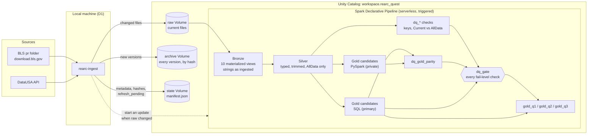

- **Why ingestion runs locally:** Free Edition serverless compute can't reach either source,
  so ingestion runs on a local machine and writes through the Databricks SDK Files API (D1).
  Everything after the Volume runs in Databricks.
- **What the pipeline reads:** only the `raw` Volume (D8).
- **When an update runs:** after an ingestion run that changed raw (D19).
- **How Gold is protected (D36):** the published Gold tables are copied from the SQL
  candidates through the gate, a write-audit-publish pattern. If any fail-level check fails,
  the update stops before Gold changes, so readers keep the last good answers. This was
  tested on the real pipeline: [docs/evidence/phase6_gate_failure_test.txt](docs/evidence/phase6_gate_failure_test.txt).

## Screenshots

Screenshots from the Databricks workspace on 2026-11-13.

### Pipeline (01–02)

**01. The pipeline's dependency graph after a completed update.** Bronze → Silver → checks
and candidates → `dq_gate` → Gold. Every published Gold table sits downstream of the gate.

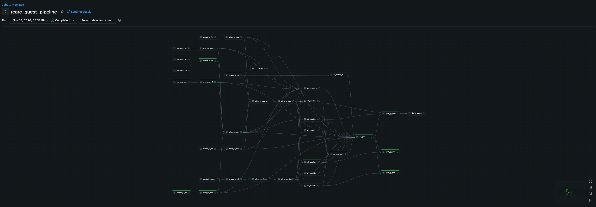

**02. Every dataset in that update, with its duration, output records and expectations.**
Each is completed, and Bronze row counts match the source files (e.g. `bronze_pr_data`
138K, `bronze_pr_series` 337).

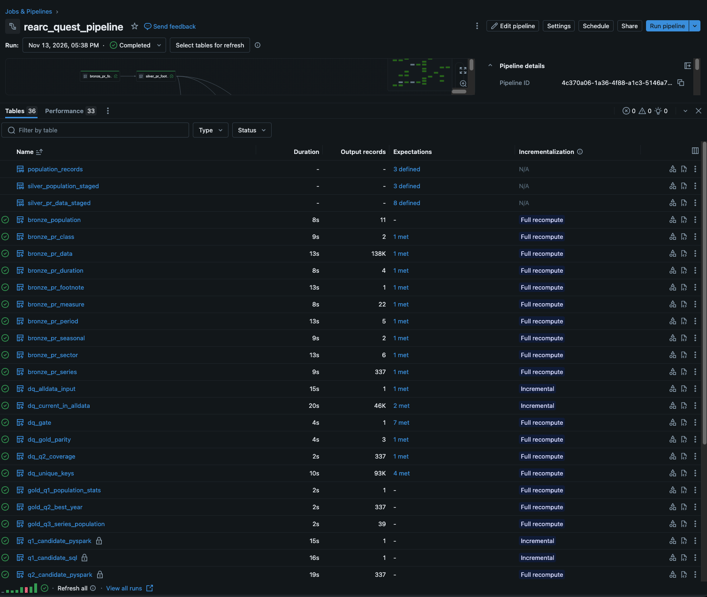

### Data quality and the gate (03–05)

**03. Silver's 8 expectations on `silver_pr_data_staged`, each with its action
(warn/ALLOW, DROP, FAIL).** Each has 0 failed records.

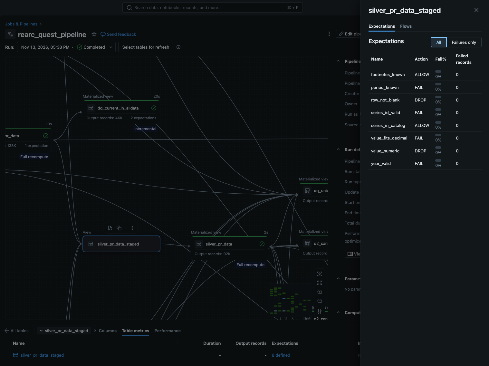

**04. The gate-failure test (Q1 temporarily required to cover 7 years).** The update failed
at `dq_gate`, and the Gold tables were skipped, so readers kept the last good answers.

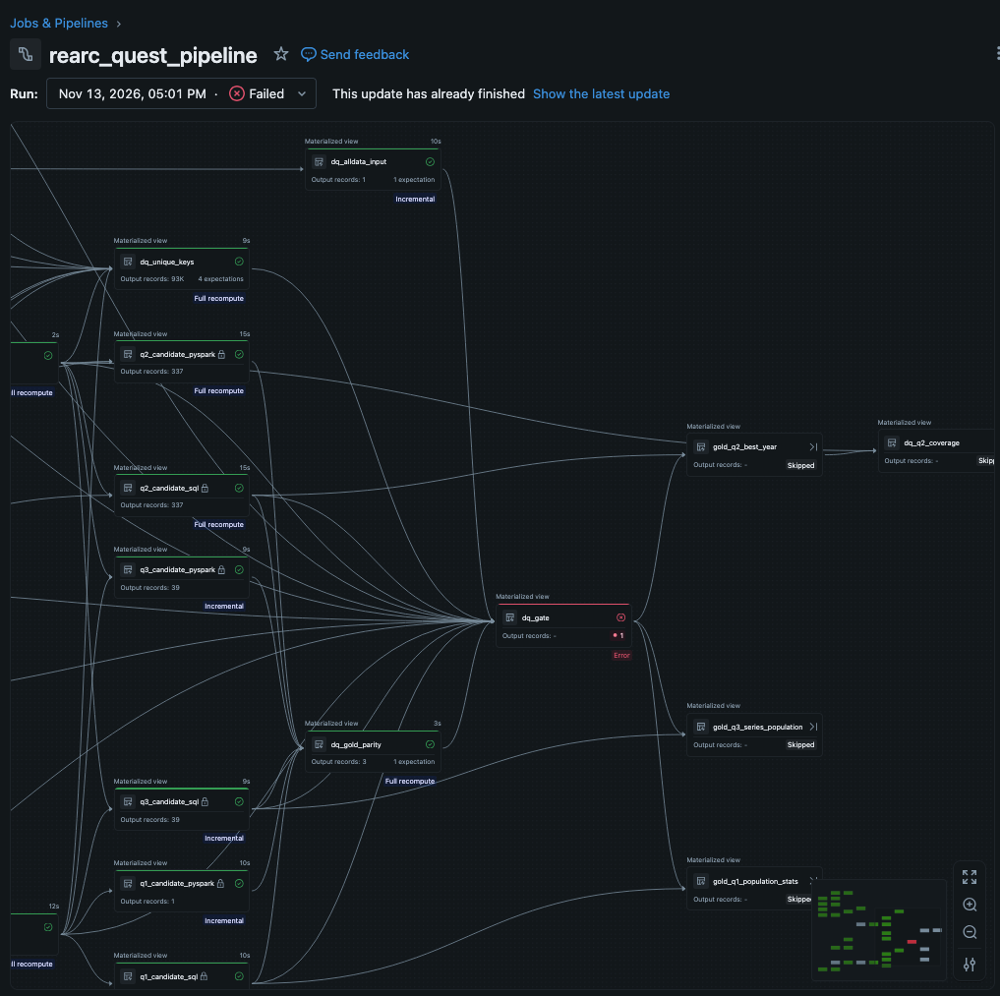

**05. The same failed update: `dq_gate`'s expectations.** `q1_six_years` has 1 failed
record. This is the check that stopped the update before Gold (D36).

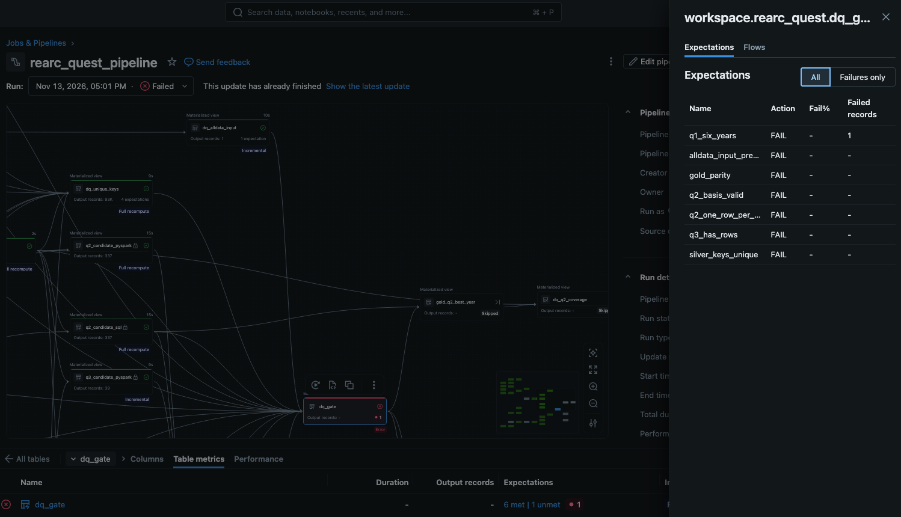

### Storage (06–08)

**06. The `workspace.rearc_quest` schema: 27 tables across Bronze, Silver, checks and Gold,
plus the `archive`, `raw` and `state` Volumes.**

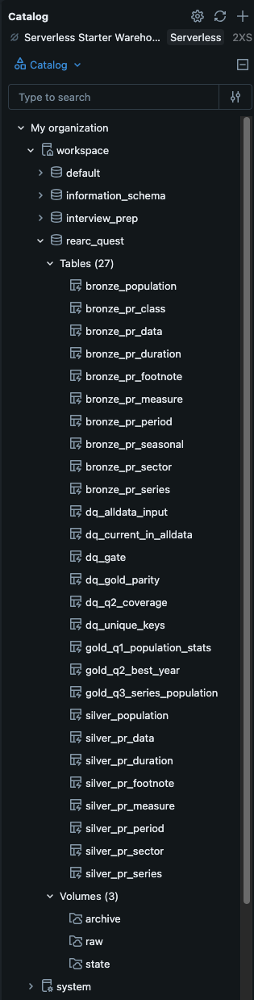

**07. The `raw` Volume's `bls/pr` folder: all 12 files from the BLS directory listing.**

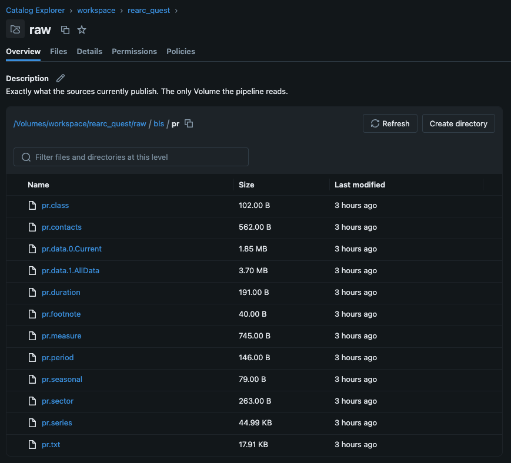

**08. The `raw` Volume's `datausa` folder: the population response saved as JSON.**

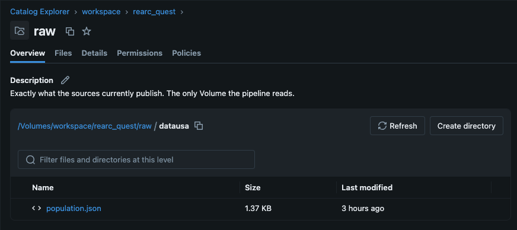

### The three answers (09–12)

**09. Q1: 6 years (2013–2018), mean 322,069,808, population standard deviation
3,796,119.94** (the answer), with sample standard deviation 4,158,441.04 alongside.

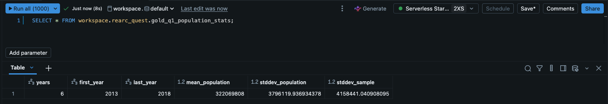

**10. Q2, first half of one result** for the two hand-checked series, PRS30006032 and
PRS84006021: labels, names and basis, with best years 1994 and 1964.

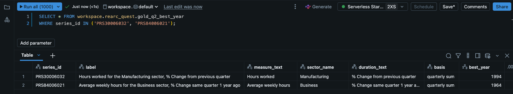

**11. Q2, second half of the same result:** best totals 14.600 and 4.900, quarter counts,
and PRS84006021's tie with 2010 in `other_tied_years`.

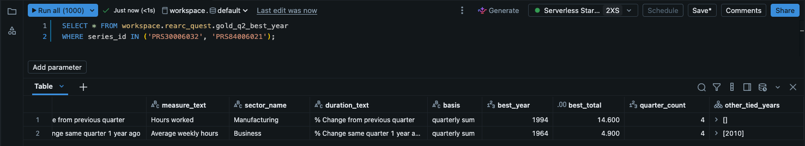

**12. Q3: PRS30006032 Q01 for all 39 years (1988–2026), with population where DataUSA has
it.** It's NULL for years DataUSA doesn't cover, including 2020.

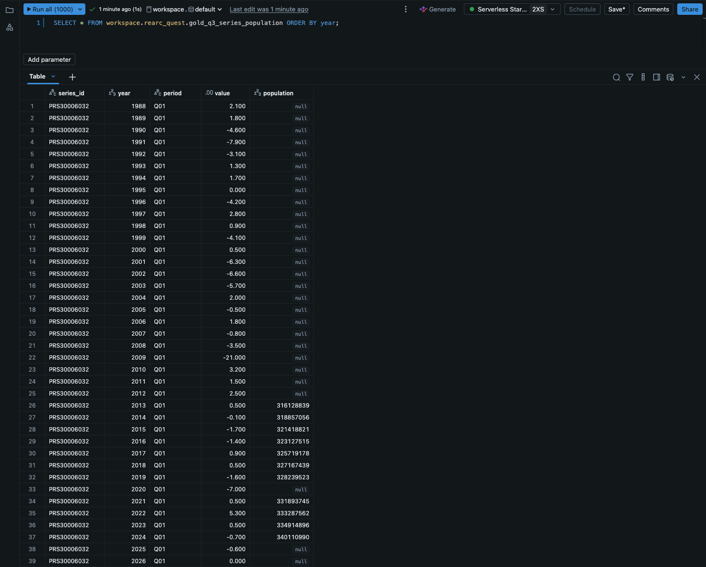

### Analyst access (13–14)

**13. `analysts` has `SELECT` on Gold:** the Permissions tab for `gold_q2_best_year`. All
three Gold tables are verified in
[docs/evidence/d38_analyst_grants.txt](docs/evidence/d38_analyst_grants.txt).

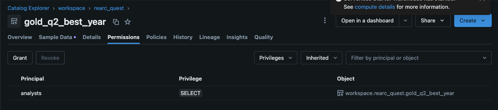

**14. `analysts` has nothing on Silver:** `silver_pr_data` has no permissions granted.

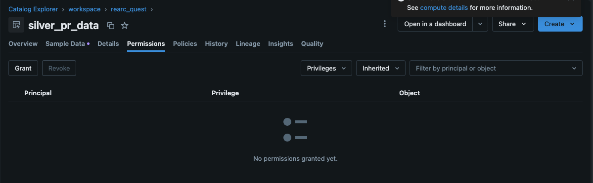

## Repository layout

| Path | What it is |
|---|---|
| `src/rearc_ingest/` | Local ingestion package and the `rearc-ingest` command |
| `src/pipeline/transformations/` | Pipeline source: Bronze and Silver in Python; Gold primaries, checks and gate in SQL; PySpark alternatives |
| `src/pipeline/utilities/` | Pure helpers shared by the pipeline and pytest |
| `databricks.yml`, `resources/` | Asset Bundle: schema, three Volumes, the pipeline, the analyst grants job |
| `src/sql/analyst_grants.sql` | Idempotent read-only grants on the Gold tables for `analysts` (D38) |
| `tests/` | pytest suite (101 tests); no network and no Databricks needed |
| `scripts/volume_check.py` | Read-only checks of the Volumes against the manifest |
| `docs/evidence/` | Saved run output cited in PROCESS.md |
| `notes/` | Decision log and AI usage log |

## Setup

Requirements:
- Python 3.11 or later.
- The Databricks CLI (v1.22 or later was used).
- A Databricks workspace. Free Edition works.

```bash
python3 -m venv .venv
.venv/bin/pip install -e '.[dev]'
cp .env.example .env                    # then set BLS_USER_AGENT to your name and email
databricks auth login --profile rearc --host <your workspace URL>
.venv/bin/pytest                        # 101 tests, no network needed
```

- **Using your own workspace:** `databricks.yml` pins the workspace host. That's
  deliberate: a deploy with the wrong profile then fails instead of landing somewhere
  else. To deploy elsewhere, change `targets.dev.workspace.host`.
- **Defaults:** the catalog `workspace` and schema `rearc_quest` are the bundle's
  defaults. A test checks they match the ingestion tool's settings.
- **BLS User-Agent:** BLS blocks automated requests that carry no contact information, so
  `BLS_USER_AGENT` must include an email address. DataUSA requests identify the tool by the
  repository URL in `pyproject.toml` instead (D20).

## Deploy

```bash
databricks bundle validate --strict --profile rearc
databricks bundle deploy --profile rearc
```

- **What it creates:** the schema, the Volumes `raw`, `archive` and `state`, the
  pipeline `rearc_quest_pipeline`, and the job `rearc_quest_analyst_grants`.
- **Protected resources:** the schema and the `archive` Volume carry
  `lifecycle.prevent_destroy`, and a pytest fails if either is removed or unprotected (D27).
- **Starting updates:** there are two triggers (D32).
  - **Data changes:** `rearc-ingest` starts an update itself.
  - **Code changes:** deploy, then start an update on purpose:
    ```bash
    databricks pipelines start-update <pipeline id> --development --profile rearc
    ```

## Analyst access (read-only Gold)

The `analysts` account group can read the three published Gold tables, and nothing else
(D38):

| Privilege | Object |
|---|---|
| `USE CATALOG` | catalog `workspace` |
| `USE SCHEMA` | schema `workspace.rearc_quest` |
| `SELECT` | `gold_q1_population_stats`, `gold_q2_best_year`, `gold_q3_series_population` |

- **What isn't granted:** `SELECT` on the schema, which would also cover Bronze, Silver,
  the checks and every future table. Nothing on any Volume.
- **How it's applied:**
  - Bundles can't declare grants on tables or materialized views, so the grants live in one
    idempotent SQL file, [src/sql/analyst_grants.sql](src/sql/analyst_grants.sql).
  - The job `rearc_quest_analyst_grants` runs it on the serverless SQL warehouse.
  - A deploy plus one run reproduces the grants:
    ```bash
    databricks bundle deploy --profile rearc
    databricks bundle run rearc_quest_analyst_grants --profile rearc
    ```
- **Guard:** `tests/test_grants.py` fails if the file grants anything on a non-Gold object,
  grants `SELECT` at schema level, or misses a Gold table.
- **Evidence:** the grants were verified with `SHOW GRANTS`, and they survive a pipeline
  refresh: [docs/evidence/d38_analyst_grants.txt](docs/evidence/d38_analyst_grants.txt).
- **Screenshots:** [13: SELECT on a Gold table](docs/screenshots/13_gold_permissions.png)
  and [14: nothing on Silver](docs/screenshots/14_silver_permissions.png).
- **Group type:** `analysts` must be an **account** group (SCIM `resourceType: Group`).
  Unity Catalog can't grant to workspace-local groups.

## Running ingestion

```bash
.venv/bin/rearc-ingest --dry-run      # show what would be downloaded or removed; write nothing
.venv/bin/rearc-ingest --no-refresh   # ingest without starting a pipeline update
.venv/bin/rearc-ingest                # ingest, then start an update if raw changed
```

| Option | Effect |
|---|---|
| `--profile NAME` | Databricks CLI profile (default `rearc`) |
| `--catalog`, `--schema` | Override the target (default `workspace.rearc_quest`) |
| `--dry-run` | Fetch the listing and print the plan; download and write nothing |
| `--allow-removals` | Permit removals the guard would refuse (D11) |
| `--max-removals N` | Removals allowed without `--allow-removals` (default 2) |
| `--no-refresh` | Don't start a pipeline update; the change stays marked as pending (D19) |

What a run does:
1. **Detects changes.** Files are discovered from the BLS directory listing, never from
   hardcoded names. A file is downloaded only if its listing timestamp or size changed (D7).
2. **Writes only real changes.** A download is written only if its SHA-256 hash changed:
   first to an archive path named by the hash, then to `raw/`, then the manifest entry
   (D10). **A second run with no source changes writes nothing:**
   [docs/evidence/phase3_second_run_unchanged.txt](docs/evidence/phase3_second_run_unchanged.txt).
3. **Mirrors removals.** Files that disappear from the listing are removed from `raw/`, and
   the archive keeps every version. A guard refuses more than 2 removals, or any
   `pr.data.*` removal, unless `--allow-removals` is passed (D11).
4. **Starts the pipeline when needed.** An update starts whenever raw has changed since the
   last successfully started update. A `refresh_pending` flag in the manifest carries this
   across failed and `--no-refresh` runs (D19), and each update runs in development mode
   (D28).

How requests are made:
- One request per second.
- Timeouts, connection errors and 5xx responses are retried with backoff.
- **An HTTP 403 stops the run immediately, without a retry.**

### Exit codes

| Code | Meaning | What to do |
|---|---|---|
| 0 | Success | Nothing. |
| 1 | Failed: fetch error after retries, unparseable listing, size mismatch, or unreadable manifest | Read the message. For a size mismatch, re-run: the file may have changed during the run (D21). For an unreadable manifest, delete `state/manifest.json` and re-run; everything is re-landed safely (D25). |
| 2 | Configuration error: `BLS_USER_AGENT` missing or without an email, repository URL missing, or refresh requested with no pipeline configured | Fix the configuration. Nothing was fetched or written. |
| 3 | HTTP 403: the server refused the request | Stop. Check `BLS_USER_AGENT` and the BLS access policy. Never retried automatically. |
| 4 | The removal guard refused the run | Nothing was changed. Check the source, then re-run with `--allow-removals` if the removals are genuine (D11). |
| 5 | Ingested, but the pipeline update couldn't be started | The change stays marked as pending, and the next run starts the update (D19). |

### Expected warnings

Every ingestion run, and every use of `scripts/volume_check.py`, prints a line like this:

```
WARNING:databricks.sdk.mixins.files:Unexpected status resolving file endpoints (403, request ID ...), using the default endpoints.
```

- **This is not the BLS 403.** The Databricks SDK probes an optional endpoint before its
  first Files API call. Free Edition refuses that probe, so the SDK falls back to the
  standard Files API, and uploads and downloads work normally.
- **No action is needed.** The run's exit code is unaffected (D22).
- **How to tell them apart:** a real BLS 403 stops the run with exit code 3 and a
  `STOPPED (403)` message naming a `download.bls.gov` URL.

## Checking the Volumes

`scripts/volume_check.py` only lists and downloads files; a test enforces that it never
writes or deletes.

```bash
.venv/bin/python scripts/volume_check.py check
.venv/bin/python scripts/volume_check.py snapshot before.json
.venv/bin/python scripts/volume_check.py compare before.json after.json
```

| Command | What it checks |
|---|---|
| `check` | For every manifest entry: the raw file's SHA-256 matches the manifest; the archive copy is named by that hash and is byte-identical; a BLS file's size equals its listing size. |
| `snapshot` | Records every file's size and last-modified time in all three Volumes, plus the manifest's hash and `refresh_pending`. |
| `compare` | Reports files added, removed or changed between two snapshots, and whether the manifest hash differs. |

When to run it:
- **`check`** after any run that wrote something.
- **`snapshot`, then `compare`**, before and after a run, to prove the run wrote nothing.

Exit codes: 0 when there are no problems, 1 otherwise.

## Volumes

| Volume | Contents |
|---|---|
| `raw` | Exactly what the sources currently publish: `bls/pr/<file>` and `datausa/population.json`. The only Volume the pipeline reads. |
| `archive` | Every version ever written, named by content hash: `<source>/<file>/<sha256>`. Protected by `prevent_destroy`. |
| `state` | `manifest.json`: per-file listing metadata, hash and status, plus the `refresh_pending` flag. |
